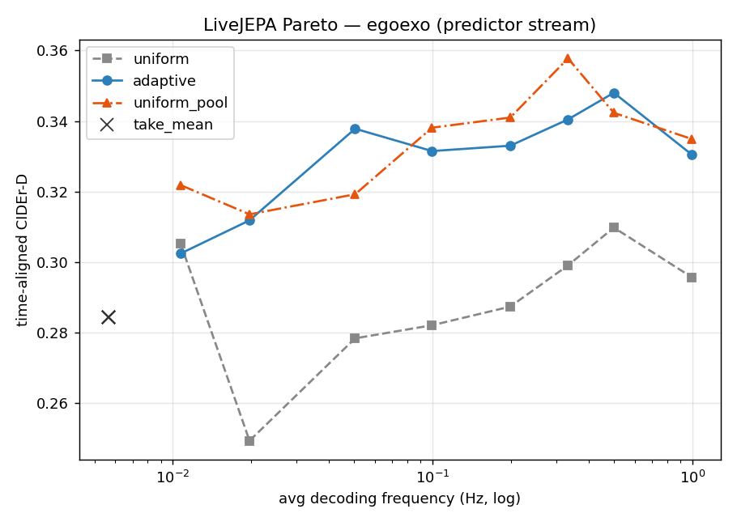
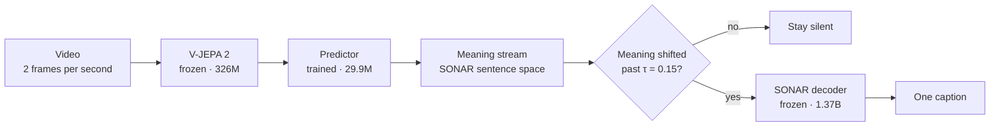

# LiveJEPA

**Video captioning that speaks only when the meaning changes.**

*LiveJEPA: Reconstructing and Stress-Testing Selective Decoding for Streaming Video
Captioning.* Master's thesis, Department of Computer Science and Engineering, IIIT
Naya Raipur.

## At a glance

- **What it is.** A working reconstruction of VL-JEPA's *selective decoding*. Live
  video becomes a continuous stream of meaning embeddings, and the expensive text
  decoder runs only when that meaning shifts.
- **Why a reconstruction.** VL-JEPA (arXiv:2512.10942) has no public code or
  weights. LiveJEPA rebuilds it from released parts (frozen V-JEPA 2 and SONAR),
  trains the missing piece (a 29.9M-parameter predictor) and implements the
  selective-decoding layer itself.
- **Main finding.** Deciding *when* to speak saves decodes on clean, redundant
  streams (≈1.6× fewer on COIN steps, ≈2.5× on EgoExo4D keysteps), but not on
  dense ones. On the stream our predictor produces, the gain over uniform decoding
  comes from **averaging, not placement**: a uniform baseline given the same
  pooling ties it.
- **Also.** The predictor improved steadily with data (cosine 0.667 → 0.846 over 9×
  more clips, still climbing). A live web demo runs on a video file or a webcam.
- **Read next.** The thesis ([PDF](thesis_materials/thesis.pdf), 34 pages), the
  paper ([PDF](thesis_materials/paper_ieee.pdf), 13 pages), or every number with
  its command in [RESULTS.md](RESULTS.md).

<p align="center">
  
  <br>
  <sub>Captioning quality vs decoding rate on 40 held-out EgoExo4D takes (predicted stream).
  Adaptive (blue) and uniform with the same pooling (orange) sit together, well above
  single-point uniform (grey). One caption per take (×) already scores 0.284.</sub>
</p>

## Contents

1. [What problem it solves](#1-what-problem-it-solves)
2. [How it works](#2-how-it-works)
3. [Key results](#3-key-results)
4. [Quick start (no GPU)](#4-quick-start-no-gpu)
5. [Run the live demo](#5-run-the-live-demo)
6. [Reproduce the thesis numbers](#6-reproduce-the-thesis-numbers)
7. [Repository map](#7-repository-map)
8. [Which document to read](#8-which-document-to-read)
9. [Models, data and hardware](#9-models-data-and-hardware)
10. [Limitations](#10-limitations)
11. [Licences and credits](#11-licences-and-credits)

---

## 1. What problem it solves

Captioning live video frame by frame is wasteful. Consecutive moments usually mean
the same thing, and the text decoder (1.37B parameters here) is the most expensive
part of the pipeline. VL-JEPA proposed **selective decoding**: keep a cheap,
continuous stream of meaning embeddings, watch it for semantic shifts, and decode
text only when the meaning moves. It reports 2.85× fewer decoding operations at
similar quality.

LiveJEPA:

- **rebuilds the pipeline** from released, frozen models: V-JEPA 2 for video,
  SONAR for text;
- **trains the missing piece**, a predictor that maps video into SONAR's sentence
  space;
- **implements selective decoding**: an online trigger for live use, and offline
  segmentation for evaluation;
- **tests the claim** against fair baselines, with paired significance tests.

Uses: narration for blind and low-vision users, indexing lectures and how-to
videos, monitoring, and assistants on smart glasses or robots.

## 2. How it works



1. **Watch.** At each step V-JEPA 2 (ViT-L) encodes the latest window of 16 frames
   sampled at 2 fps, that is 8 seconds of video.
2. **Predict.** The predictor, a 4-layer transformer trained with InfoNCE plus
   cosine loss, maps the window to a 1024-dimensional SONAR sentence embedding. It
   is rescaled to SONAR's native norm (0.196) so the decoder can read it.
3. **Decide.** The stream is smoothed over 3 steps. The trigger measures the shift
   `1 − cos(newest step, centroid of the last 8 steps)`; past τ = 0.15 it closes
   the current segment.
4. **Speak.** The SONAR decoder turns the closed segment's mean embedding into one
   sentence. Otherwise the decoder stays off.

The SONAR *text encoder* (766M, frozen) embeds the ground-truth captions that the
predictor learns to hit. It is used only for training.

**The decoding schedules compared** (`python -m livejepa.run_eval --methods ...`):

| Schedule | What gets decoded |
|---|---|
| `adaptive` | the mean of each segment: Ward segmentation offline, `SegmentTrigger` online |
| `uniform` | one raw step every 1/f seconds (the original baseline) |
| `uniform_pool` | same count and timestamps as `uniform`, but the mean of each fixed block: the same pooling adaptive gets, as in VL-JEPA's own protocol |
| `take_mean` | one caption per video, from the mean of the whole stream (a timing-free reference) |

## 3. Key results

All numbers use real SONAR decoding and the paper's time-aligned CIDEr-D. The last
column points to the section of [RESULTS.md](RESULTS.md) with the full table and
the command that produced it.

### Selective decoding: it depends on the stream

| Stream | Benchmark | Result | RESULTS.md |
|---|---|---|---|
| Ground truth, coarse | COIN steps (26 videos) | adaptive matches uniform's quality with **≈1.6× fewer decodes** | §1 |
| Ground truth, coarse | EgoExo4D keysteps (10 takes) | **≈2.5× fewer decodes** | §1 |
| Ground truth, dense | EgoExo4D atomic descriptions, the paper's benchmark (218 takes) | **uniform wins at all 8 rates**; an event every ~2 s leaves nothing to segment | §5 |
| Predicted (in-domain predictor) | same atomic benchmark (40 held-out takes) | adaptive beats single-point uniform at **7 of 8** rates, but **ties uniform+pool at 6 of 8** (one significant win each way); uniform+pool has the best score, 0.358 vs 0.348 | §5b |

### On a predicted stream, the gain is averaging

- Pooling alone lifts uniform decoding by **+5% to +26%** CIDEr at every rate.
- One caption per video (0.284) scores about what uniform gets with 1,412 decodes
  at 0.2 Hz (0.287), so this benchmark barely rewards *timing*.
- On the semantic metric (SONAR cosine to the ground truth), uniform+pool is
  significantly better than adaptive at all 8 rates.
- The earlier "≈9.9× fewer decodes" headline compared pooled adaptive with unpooled
  uniform. It does not survive the fair baseline; the thesis reports the corrected
  result.

### The predictor: data was the bottleneck

Same architecture and training recipe; only the amount of training data grows.
Cosine similarity to the true SONAR embedding on 956 held-out samples:

| Training clips | Held-out cosine | Prediction similarity (lower = more diverse) |
|---:|---:|---:|
| 2,962 (COIN subset) | 0.667 | 0.527 |
| 5,529 | 0.733 | 0.467 |
| **26,360 (99.6% of COIN's training videos)** | **0.846** | **0.408** |

- The curve is still climbing. This model, `checkpoints_c1_final/predictor_30000.pt`,
  is the one the demo serves (§4).
- Training on Action100M, VL-JEPA's own data, did **not** help at our scale (6,710
  clips), either instead of COIN or added to it (§6, §6b).
- An in-domain EgoExo4D predictor raised CIDEr on that benchmark **25×** (0.012 →
  ~0.33) (§5b).

## 4. Quick start (no GPU)

The selective-decoding logic runs without a GPU or model downloads: the smoke test
and the unit tests use synthetic embeddings.

```bash
pip install numpy scipy scikit-learn pyyaml pycocoevalcap pytest
python -m livejepa.eval_pareto      # synthetic 5-event stream: CIDEr vs decode rate
python -m pytest tests/ -q          # 16 unit tests
```

In the smoke test's output, adaptive keeps its top score (8.0) down to 0.05 Hz,
while uniform drops below it from 0.2 Hz.

## 5. Run the live demo

The web app (FastAPI) streams captions from a sample video, an upload or a webcam.
It shows the trigger at work: a semantic-shift meter against τ, decode counters, a
timeline, and a caption track you can download as `.srt`.

| Route | Page |
|---|---|
| `/` | landing page: the idea, an animated meaning line, results |
| `/demo` | the live demo: sample videos, upload or webcam; adaptive or uniform |
| `/about` | architecture and results |

**On your own machine.** This needs a CUDA GPU with about 8 GB, and the trained
checkpoint `checkpoints_c1_final/predictor_30000.pt`. Checkpoints are not in git;
the cloud bundle below contains them.

```bash
pip install -r requirements.txt
python -m uvicorn webapp.backend:app --host 127.0.0.1 --port 8000
# then open http://127.0.0.1:8000
```

On Windows, `webapp\start_server.ps1` does the same, with logging and auto-restart.
The first start downloads V-JEPA 2 and the SONAR decoder (about 7 GB) from Hugging
Face.

**On a rented cloud GPU** (RunPod or Vast.ai; HTTPS, so the webcam works):

1. `python scripts/make_cloud_bundle.py` packs code, checkpoints and sample videos
   into `livejepa_cloud.zip`.
2. On the pod, `bash deploy/cloud_setup.sh` installs, checks the GPU and the
   models, starts the server and prints the link to open.
3. Set `LIVEJEPA_TOKEN` and share `https://<address>/?token=<token>`.

Step by step: [deploy/README_CLOUD.md](deploy/README_CLOUD.md). The web app in
detail: [webapp/README.md](webapp/README.md).

**What to expect.**

- A **What it can say** switch picks the predictor: *how-to steps* (COIN, 747
  instructional captions, the default) or *everyday actions* (EgoExo4D, 6,888
  first-person descriptions; broader but looser). Neither can caption arbitrary
  scenes: the predictor says things close to what it was trained on.
- Captions appear only when the scene's meaning changes; a still scene stays silent
  by design.
- The first caption needs 8 seconds of video plus 8 windows of context: about 50
  seconds on the local T1000 laptop GPU (measured with a simulated webcam), much
  sooner on a fast GPU.
- One session runs at a time; a second viewer gets "GPU busy".

A command-line version also exists:
`python -m livejepa.demo --source <video file or webcam index> --save-video out.mp4`.

## 6. Reproduce the thesis numbers

These need the datasets and checkpoints, which are not in git (see
[§9](#9-models-data-and-hardware)). Each command writes `results_*.json` and
`results_*.png` to the repository root. The curated copies cited by the thesis are
in [thesis_materials/figures/](thesis_materials/figures/).

```bash
# §1   mechanism on ground-truth streams
python -m livejepa.run_eval --dataset coin --mode gt
python -m livejepa.run_eval --dataset egoexo --mode gt --gt-source keystep \
    --max-videos 10 --max-seconds 300

# §4   predictor quality (the data-scaling study)
python scripts/eval_predictor.py --ckpt checkpoints_c1_final/predictor_30000.pt \
    --val data_cache_coin_full_val

# §5   the paper's benchmark on the ground-truth stream, 218 takes
python -m livejepa.run_eval --dataset egoexo --mode gt --gt-source atomic \
    --uids-file eval_data/egoexo_takes_218.txt --max-seconds 360 \
    --out results_egoexo_atomic_218

# §5b  the predicted stream with all four schedules, then the paired bootstrap
python -m livejepa.run_eval --dataset egoexo --mode predictor \
    --ckpt checkpoints_egoexo/predictor_20000.pt --gt-source atomic \
    --uids-file eval_data/egoexo_takes_pred40.txt --max-seconds 360 \
    --methods uniform,adaptive,uniform_pool,take_mean \
    --decode-cache eval_data/decode_cache_egoexo_indomain.jsonl \
    --out results_egoexo_predictor_40_indomain_pooled
python scripts/eval_rigor.py --ckpt checkpoints_egoexo/predictor_20000.pt \
    --uids-file eval_data/egoexo_takes_pred40.txt --max-seconds 360 \
    --methods uniform,adaptive,uniform_pool,take_mean --boot 5000 \
    --out results_egoexo_rigor_pooled
```

[RESULTS.md](RESULTS.md) lists every other experiment: ablations, the trigger-tuning
sweep, the ceiling analysis, the semantic metric and the Action100M rungs.

**Build the thesis PDF** (details in [thesis_materials/BUILD.md](thesis_materials/BUILD.md)):

```bash
python scripts/md_to_latex.py        # docs/THESIS.md -> thesis_body.tex
python scripts/check_thesis_tex.py   # every figure resolves, every reference binds
cd thesis_materials && tectonic -k -o . thesis.tex
```

## 7. Repository map

```
livejepa/                  the Python package
├── encoders/vision.py     V-JEPA 2 feature extractor (frozen)
├── encoders/sonar.py      SONAR encode / decode (each half loads on first use)
├── predictor/model.py     the trained predictor (4-layer transformer, 29.9M)
├── predictor/losses.py    InfoNCE + cosine regression
├── predictor/infer.py     load a checkpoint, rescale to SONAR's native norm
├── selective/online.py    streaming trigger (SegmentTrigger)     <- contribution
├── selective/offline.py   Ward segmentation, temporally linked   <- contribution
├── selective/pooling.py   smoothing and average pooling
├── data/                  COIN / EgoExo4D / Action100M loaders, cache, CIDEr
├── train.py               train the predictor
├── run_eval.py            video -> stream -> schedules -> CIDEr sweep
├── eval_pareto.py         sweep helpers + the synthetic smoke test
└── demo.py                command-line demo (OpenCV, --save-video)
webapp/                    FastAPI backend + the pages /, /demo, /about
scripts/                   evaluation, data, figures, thesis build, bundles
configs/default.yaml       every hyperparameter
tests/                     unit tests (16)
deploy/                    cloud-GPU kit (RunPod / Vast.ai), Kaggle autopilot
notebooks/                 Kaggle / Colab notebooks (generated: don't hand-edit)
docs/                      thesis source (THESIS.md), context, design, plans
thesis_materials/          thesis.pdf, paper_ieee.pdf, LaTeX, tables, figures
RESULTS.md                 every result with the command that produced it
HANDOFF.md, WORKLOG.md     project state, and the day-by-day log
```

The scripts you are most likely to need:

| Script | What it does |
|---|---|
| `eval_rigor.py` | per-take scores and paired bootstrap significance |
| `eval_semantic_pareto.py` | the semantic metric (SONAR cosine) with controls |
| `eval_ceiling.py` | upper bounds: dense, best-frame, best-window |
| `eval_predictor.py` | a checkpoint's held-out cosine, optionally with decoded captions |
| `build_coin_cache.py`, `build_egoexo_cache.py` | build training caches from video |
| `merge_cache_tar.py` | merge an extraction lane into the master cache (the only safe way) |
| `make_thesis_figures.py` | regenerate the thesis figures |
| `make_cloud_bundle.py` | build `livejepa_cloud.zip` for a cloud GPU |
| `bench_live.py` | measure seconds per window on this GPU |

## 8. Which document to read

| I want to… | Read |
|---|---|
| understand the idea and the motivation | [docs/PROJECT_CONTEXT.md](docs/PROJECT_CONTEXT.md) |
| read the thesis | [thesis_materials/thesis.pdf](thesis_materials/thesis.pdf); source in [docs/THESIS.md](docs/THESIS.md) |
| read the paper | [thesis_materials/paper_ieee.pdf](thesis_materials/paper_ieee.pdf) (IEEE format) |
| check a number, or rerun it | [RESULTS.md](RESULTS.md) |
| see all tables and figures in one place | [thesis_materials/INDEX.md](thesis_materials/INDEX.md), [thesis_materials/TABLES.md](thesis_materials/TABLES.md) |
| build the PDFs | [thesis_materials/BUILD.md](thesis_materials/BUILD.md) |
| understand the web app's design | [docs/SYSTEM_DESIGN.md](docs/SYSTEM_DESIGN.md), [webapp/README.md](webapp/README.md) |
| deploy on a cloud GPU | [deploy/README_CLOUD.md](deploy/README_CLOUD.md) |
| pick up the project where it stands | [HANDOFF.md](HANDOFF.md), then the newest entry in [WORKLOG.md](WORKLOG.md) |
| follow the working rules for continuing it | [CLAUDE.md](CLAUDE.md), [SUCCESSOR_GUIDE.md](SUCCESSOR_GUIDE.md) |

`docs/LiveJEPA_Master_Project_Plan.md` and `docs/COMPLETION_PLAN.md` are the
original plans, kept for history; everything in them is done.

## 9. Models, data and hardware

**Models.** Downloaded from Hugging Face on first use; none are gated.

| Role | Model | Parameters | Status |
|---|---|---:|---|
| video encoder | `facebook/vjepa2-vitl-fpc64-256` | 326M | frozen |
| predictor | this repository (`livejepa/predictor/`) | 29.9M | trained |
| text decoder | `raxtemur/SONAR_200_text_decoder` | 1.37B | frozen |
| text encoder (training targets only) | `cointegrated/SONAR_200_text_encoder` | 766M | frozen |

On Windows, SONAR runs through its transformers port
(`encoders.sonar.backend: transformers` in `configs/default.yaml`).

**Data.**

- **COIN** (instructional videos, 180 tasks): 8,984 of 9,023 training videos
  (99.6%) became 26,360 training clips; validation is 956 diverse held-out samples.
- **EgoExo4D** (needs a licence agreement): keysteps and atomic descriptions; 218
  density-matched validation takes. The in-domain training set has 11,556 pairs
  from 627 takes, excluding the 40 evaluation takes.
- **Action100M-preview** (VL-JEPA's own data): 6,710 clips, for the C2 and C3
  experiments.

**Hardware.**

- a local NVIDIA T1000 (8 GB): evaluation, the demo server, light training;
- free Kaggle T4 sessions: training bursts;
- a rented RTX 4090: the Action100M experiment and the cloud demo.

**Not in git:** checkpoints (`checkpoints*/`), datasets, caches and evaluation take
lists (`eval_data/`, `data_cache*/`), regenerated results in the root, and bundles
(`*.zip`).

## 10. Limitations

- The predicted-stream comparison uses 40 takes, not all 218; a full rerun would
  take about 84 hours on the T1000. More takes would tighten the ties.
- Those 40 takes share participants with the in-domain training takes. A
  participant-disjoint retrain (483 takes, 8,822 pairs) is still open.
- The full-system COIN comparison has only 7 held-out videos left on disk.
- Absolute CIDEr is low (about 0.33): free-form egocentric narration is hard, and
  the predictor saw 11.5k samples.
- The non-replication is specific to this reconstruction. VL-JEPA's predictor
  (490M, trained on Action100M, in its own embedding space) may produce a stream
  where placement matters.
- The T1000 is not real-time (several seconds per window); live use needs a faster
  GPU.

## 11. Licences and credits

- **Licences.** V-JEPA 2 is MIT; SONAR is CC-BY-NC-4.0. That is fine for academic
  use but not commercial; a commercial version would need its own
  embedding-to-text decoder.
- **Built on** VL-JEPA (Chen, Shukor et al., 2025), V-JEPA 2 (Assran et al., 2025)
  and SONAR (Duquenne et al., 2023), with the COIN, EgoExo4D and Action100M
  datasets. Full references: [thesis_materials/references.bib](thesis_materials/references.bib).
- **Author:** Aman Parganiha, Department of Computer Science and Engineering, IIIT
  Naya Raipur.
- **Guide:** Kumar Gaurav Atram, Department of Data Science and Artificial
  Intelligence, IIIT Naya Raipur.
